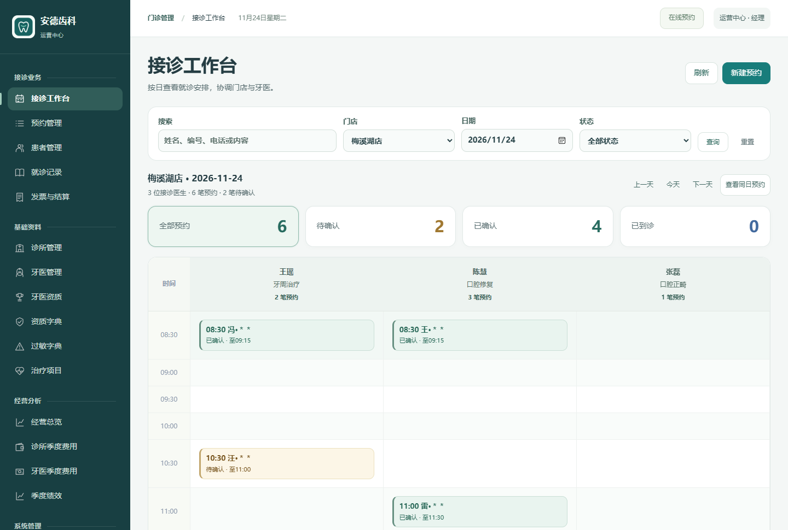
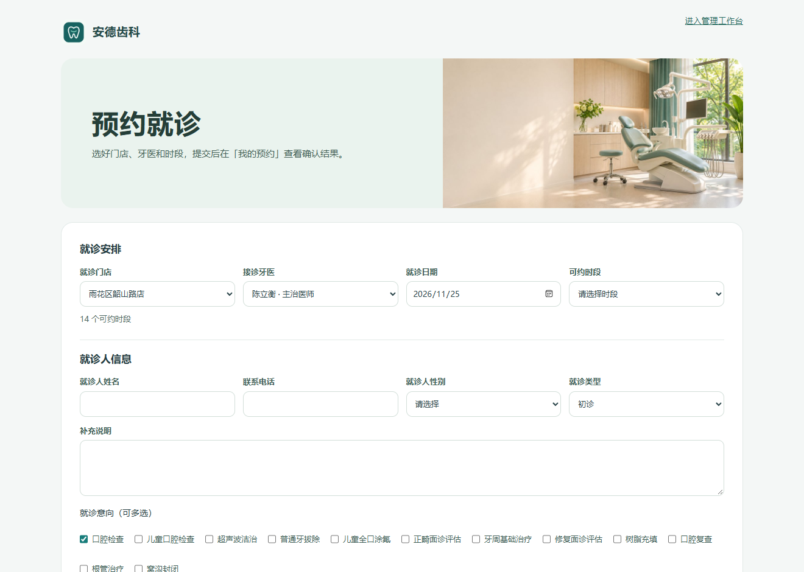
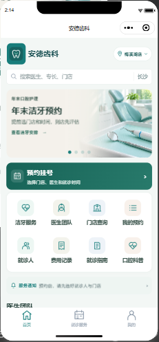

# 安德齿科｜系统体验

**腾讯云网站地址**

[https://adc-clinic-d8g65sza619c093ff-1527259437.ap-shanghai.app.tcloudbase.com/api/workspace](https://adc-clinic-d8g65sza619c093ff-1527259437.ap-shanghai.app.tcloudbase.com/api/workspace)

如打开时出现腾讯云安全提示，请等待约 3 秒，再点击「确定访问」进入系统。

**患者端小程序**

毕老师，您的微信账号已设为小程序体验员。请使用该账号扫描下方二维码，体验码在 **12 月 1 日前有效**。

## 界面预览

**网站大厅** · 门店排班与预约状态

**网页预约** · 选择门店、医生与时段

**小程序** · 患者首页与预约页

 

[课程报告（PDF）](%E4%BF%A1%E7%AE%A1T2401%E7%8F%AD%20%E6%9D%A8%E6%B5%A9%E4%B8%9C%208210242320.pdf)
